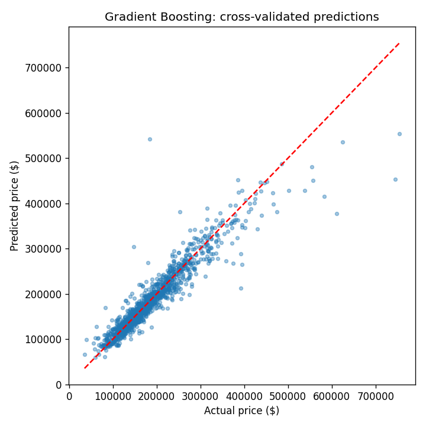

# House Price Prediction

Predicting house sale prices (Ames, Iowa) with supervised regression, from raw data to a validated model.
Data: [Kaggle — House Prices: Advanced Regression Techniques](https://www.kaggle.com/c/house-prices-advanced-regression-techniques).

## Pipeline
| Notebook | What it does |
|---|---|
| `01_data_loading.ipynb` | Loads train/test, separates the target, combines features for consistent cleaning |
| `02_data_cleaning.ipynb` | Drops sparse/redundant features, imputes missing values with domain rules, ordinal + one-hot encoding (79 → 154 features) |
| `03_modeling.ipynb` | Trains 5 models on log(price), compares them with 5-fold cross-validation, feature importance |

## Results (5-fold CV, 1376 houses)
| Model | RMSE (log) | RMSE ($) | MAE ($) |
|---|---|---|---|
| **Gradient Boosting** | **0.118** | **26,528** | **14,808** |
| Random Forest | 0.139 | 30,921 | 17,964 |
| Ridge | 0.141 | 46,047 | 17,172 |
| Linear Regression | 0.145 | 49,906 | 17,877 |
| Baseline (mean) | 0.380 | 80,203 | 55,225 |

Gradient Boosting cuts MAE by 73% versus the baseline. Top features: overall quality, living area, basement size.



## Run
1. Download `train.csv` and `test.csv` from Kaggle into `data/raw_data/`.
2. Install and run:
```bash
pip install -r requirements.txt
jupyter notebook notebooks/
```
Run the notebooks in order (01 → 03).

## Stack
Python · pandas · NumPy · scikit-learn · Matplotlib · Jupyter
